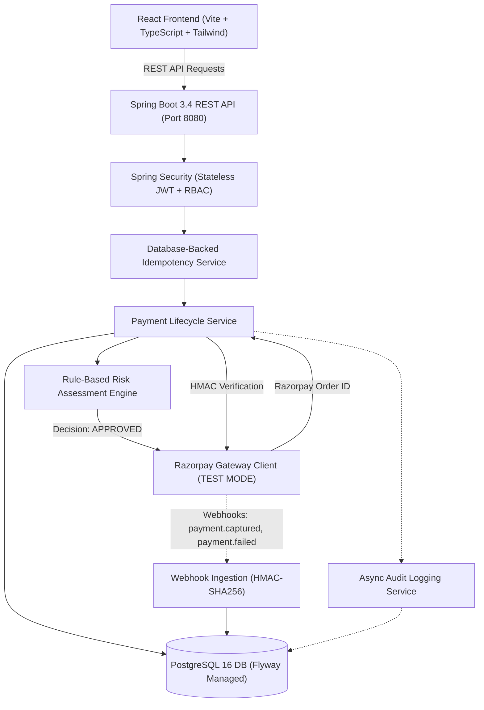

# PayShield — UPI Payment Authorization, Risk Assessment & Transaction Monitoring Platform


> **IMPORTANT DISCLAIMER**: This application operates exclusively in **Razorpay TEST MODE** for educational and demonstration purposes. No real monetary transactions or banking rails are touched.

---

## 1. Project Overview

**PayShield** is an authorization, pre-flight fraud risk assessment, and transaction monitoring platform designed to demonstrate backend and frontend engineering practices for a **Software Engineering Intern application at PayPal**.

Rather than implementing a simple wallet or passive dashboard, PayShield demonstrates an end-to-end payment workflow:
1. **Pre-flight Risk Assessment**: Evaluates transactions before creating an upstream gateway order.
2. **Deterministic Risk Categorization**: Classifies transactions into `APPROVED`, `REVIEW_REQUIRED`, or `DECLINED` based on configurable risk heuristics (velocity, volume, failure rate, and geographic anomaly).
3. **Razorpay Standard Checkout Integration**: Dynamically loads and launches Razorpay UPI checkout in TEST MODE with supported mock identifiers (`success@razorpay` and `failure@razorpay`).
4. **Server-Side HMAC-SHA256 Signature Verification**: Eliminates client-side trust by strictly verifying signature authenticity on the backend before capturing payment.
5. **Database-Backed Idempotency**: Guarantees zero duplicate order creations using database unique constraints and SHA-256 canonical payload hashing.
6. **Auditability & Webhook Ingestion**: Ingests gateway events with replay protection and maintains immutable security audit logs.

---

## 2. System Architecture



---

## 3. Payment Lifecycle


---

## 4. Risk Assessment Engine

PayShield features an explainable, deterministic rule-based fraud risk engine. Every evaluation produces an aggregate score (clamped between `0` and `100`), an explicit decision, and structured explanations:

| Rule | Metric | Threshold | Added Risk Weight |
|---|---|---|---|
| **Rule 1: Transaction Amount** | Minor units (paise) | Elevated: &gt; ₹5,000<br/>High Risk: &gt; ₹20,000 | +12 points<br/>+25 points |
| **Rule 2: Transaction Velocity** | Rolling time windows | &gt; 3 transactions / 60 seconds<br/>&gt; 5 transactions / 5 minutes | +30 points |
| **Rule 3: Repeated Failures** | Recent failure history | &gt;= 3 recent failures (last hour)<br/>&gt;= 1 recent failure | +20 points<br/>+10 points |
| **Rule 4: Geographic Anomaly** | Location deviation | Mismatch with last 5 customer transactions | +25 points |

### Decision Thresholds
- **`0 – 29`**: **`APPROVED`** &rarr; Order is sent to Razorpay Gateway; checkout proceeds.
- **`30 – 59`**: **`REVIEW_REQUIRED`** &rarr; Transaction saved as `PENDING_REVIEW`; gateway order is held for manual admin review.
- **`60 – 100`**: **`DECLINED`** &rarr; Transaction rejected immediately; zero gateway order is created.

---

## 5. Technology Stack

### Backend
- **Java 21** (Temurin LTS)
- **Spring Boot 3.4.0** (Spring Web, Spring Data JPA, Spring Security, Actuator, Validation)
- **PostgreSQL 16** with **Flyway** migrations
- **Razorpay Java SDK 1.4.6**
- **JJWT 0.12.3** (HMAC-SHA256 stateless tokens)
- **Springdoc OpenAPI 2.6.0** (Swagger UI)

### Frontend
- **React 18** with **TypeScript**
- **Vite 6**
- **Tailwind CSS 3.4**
- **React Router 7**
- **Recharts 2.15** (Data telemetry & analytics)
- **Lucide React** (Fintech UI icons)
- **Axios** (With Bearer token interceptors)

### Infrastructure & QA
- **Docker & Docker Compose**
- **JUnit 5**, **Mockito**, **MockMvc**

---

## 6. Seed Accounts & Credentials

For immediate development and assessment, PayShield initializes default accounts at startup:

| Role | Email | Password | Access Scope |
|---|---|---|---|
| **CUSTOMER** | `customer@payshield.com` | `Customer@123` | Initiate payment, review risk breakdown, test UPI checkout, history, refund |
| **ADMIN** | `admin@payshield.com` | `Admin@123` | Platform volume metrics, failure cascades, flagged queue, audit logs |

---

## 7. Quick Start & Execution

### Prerequisites
- Java 21 JDK
- Node.js (v20+) & npm
- PostgreSQL 16 (or Docker)

### Option A: Running with Docker Compose (Recommended)

```bash
# Clone the repository
cd payshield

# Copy environment variables
cp .env.example .env

# Start PostgreSQL and Backend
docker-compose up --build -d

# Start Frontend
cd frontend
npm install
npm run dev
```

Visit the frontend at `http://localhost:5173`.

---

### Option B: Running Locally

#### 1. Start PostgreSQL
Ensure PostgreSQL is running locally on port `5432` with a database named `payshield` (`user: payshield`, `password: payshield123`).

#### 2. Run Backend
```powershell
cd backend
# Set JAVA_HOME if not on default PATH
$env:JAVA_HOME = "C:\Users\Dell\AppData\Local\Programs\Eclipse Adoptium\jdk-21.0.13.9-hotspot"

# Run tests
& "E:\pay\maven\apache-maven-3.9.9\bin\mvn.cmd" test "-Dspring.profiles.active=test"

# Start Spring Boot application
& "E:\pay\maven\apache-maven-3.9.9\bin\mvn.cmd" spring-boot:run
```
Backend runs on `http://localhost:8080`.  
Swagger UI is live at: `http://localhost:8080/swagger-ui/index.html`.

#### 3. Run Frontend
```powershell
cd frontend
npm install
npm run dev
```
Frontend runs on `http://localhost:5173`.

---

## 8. Steps to Perform a Simulated UPI Payment

1. Open `http://localhost:5173` in your browser.
2. Click **"Fill Customer"** (`customer@payshield.com` / `Customer@123`) and click **Sign In**.
3. In the Customer Dashboard, click **Pay Now**.
4. Enter an amount:
   - **Normal Test**: Enter `₹500` &rarr; Click **Evaluate Risk & Proceed**.
   - Notice the Risk Engine outputs `APPROVED` with a score of `0` and reasons.
5. Click **Open Razorpay UPI Checkout**.
6. The official Razorpay modal appears in **TEST MODE**:
   - Select **UPI / QR**.
   - Under UPI ID, enter: `success@razorpay`.
   - Click **Pay Now**.
7. The payment is processed by Razorpay test gateway, redirected to backend verification (`/api/v1/payments/verify`), and signature is verified using HMAC-SHA256.
8. The UI redirects to the **Transaction Details** screen displaying `CAPTURED` status and gateway order/payment IDs.
9. To test a failure, initiate another transaction and enter `failure@razorpay` in the UPI prompt.

---

## 9. Automated Testing Verification

All 22 unit and integration tests execute successfully without internet dependency:

```text
[INFO] -------------------------------------------------------
[INFO]  T E S T S
[INFO] -------------------------------------------------------
[INFO] Running com.payshield.auth.AuthControllerTest
[INFO] Tests run: 3, Failures: 0, Errors: 0, Skipped: 0
[INFO] Running com.payshield.idempotency.IdempotencyServiceTest
[INFO] Tests run: 4, Failures: 0, Errors: 0, Skipped: 0
[INFO] Running com.payshield.payment.PaymentServiceTest
[INFO] Tests run: 4, Failures: 0, Errors: 0, Skipped: 0
[INFO] Running com.payshield.risk.RiskAssessmentEngineTest
[INFO] Tests run: 8, Failures: 0, Errors: 0, Skipped: 0
[INFO] Running com.payshield.webhook.WebhookControllerTest
[INFO] Tests run: 3, Failures: 0, Errors: 0, Skipped: 0
[INFO] 
[INFO] Results:
[INFO] 
[INFO] Tests run: 22, Failures: 0, Errors: 0, Skipped: 0
[INFO] 
[INFO] ------------------------------------------------------------------------
[INFO] BUILD SUCCESS
[INFO] ------------------------------------------------------------------------
```

---

## 10. Security Compliance Summary

- [x] **No Secret Leakage**: `RAZORPAY_KEY_SECRET` and `RAZORPAY_WEBHOOK_SECRET` are never bundled into client JS.
- [x] **Zero Floating-Point Financials**: All amounts are represented as `BIGINT` in paise / minor units.
- [x] **Database Constraints**: `idempotency_key` and `razorpay_event_id` have unique database indexes.
- [x] **Constant-Time Verification**: HMAC-SHA256 signature verification utilizes constant-time byte comparisons to prevent timing side-channel attacks.
- [x] **Ownership Enforcement**: Customers can only inspect their own transactions; customer-to-customer data traversal is strictly blocked.

---

## 11. Author

**PayShield Engineering Team**  
Designed and built for the **Software Engineering Intern Application at PayPal**.
