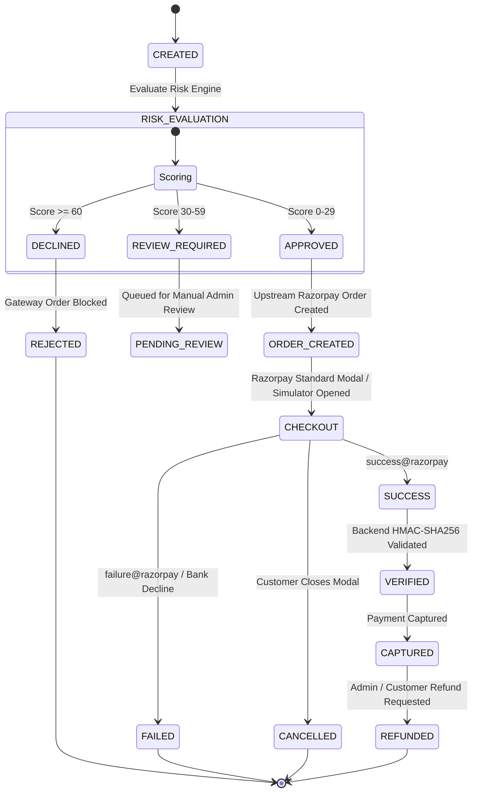

# PayShield — UPI Payment Authorization, Risk Assessment & Transaction Monitoring Platform


> **IMPORTANT DISCLAIMER**: This application operates exclusively in **Razorpay TEST MODE** for educational and demonstration purposes. No real monetary transactions or banking rails are touched.

---

## Executive Summary: Purpose, Target Audience & Market Differentiation

### 1. Who is PayShield for?
* **E-Commerce & High-Volume Digital Platforms**: Merchants who need to protect their checkout flow from bot attacks, fraud rings, and chargeback liabilities.
* **Fintech Platforms & Payment Aggregators**: Technology platforms (modeled after **PayPal Risk Management**, **Stripe Radar**, and **Adyen**) that evaluate transactions before routing them to banking networks.
* **Compliance & Risk Operations Teams**: Fraud analysts and operations engineers who require real-time telemetry, automated velocity triggers, explainable decision matrices, and immutable audit trails.
* **Software Engineering Hiring Teams & Assessors**: Built specifically to showcase robust, institutional fintech system design, safe distributed state handling, and defensive coding for a **Software Engineering Intern application at PayPal**.

---

### 2. What is PayShield's Purpose?
In enterprise fintech, a web application should **never** directly relay customer checkout requests straight into banking rails or payment gateways without pre-flight risk evaluation. 

PayShield acts as the **intelligent authorization gatekeeper and transaction monitoring platform**:
1. **Pre-flight Risk Assessment**: Before an upstream order is ever created with a payment gateway, PayShield evaluates the transaction using an explainable, deterministic rule engine.
2. **Three-Tier Decisioning**: Categorizes payments into `APPROVED` (order created, proceed to checkout), `REVIEW_REQUIRED` (held for fraud team review), or `DECLINED` (rejected immediately to save interchange fees and prevent fraud).
3. **Idempotency Protection**: Ensures zero double-charging or duplicate order creation during client double-clicks or intermittent network retries using database-level unique constraints and SHA-256 payload hashing.
4. **Cryptographic Gateway Verification**: Server-side validation of payment signatures using constant-time HMAC-SHA256 byte comparison to prevent frontend tampering.
5. **Full Operational Oversight**: Complete admin portal with real-time risk distribution metrics, failure cascade monitoring, and append-only audit logging.

---

### 3. Why is PayShield Needed When Consumer UPI Apps (Google Pay, PhonePe, Paytm) Already Exist?

A common question is: *"Why do we need PayShield if consumer apps like Google Pay, PhonePe, and Paytm already process UPI payments?"*

The answer lies in **understanding the two different sides of the payment ecosystem**:

```
[Consumer / Payer Side]                [Platform / Merchant Risk Gatekeeper]               [Settlement & Banking Rails]
+-------------------------+            +------------------------------------+              +---------------------------+
|   Google Pay / PhonePe  |  Request   |             PayShield              |  API Order   |     Razorpay / NPCI /     |
| (Client TPAP UPI App)   | ---------> |  1. Pre-flight Fraud Evaluation    | -----------> |        Acquiring Bank     |
|                         |            |  2. Idempotency Key Validation     |              |                           |
| - Scan QR / Enter VPA   |            |  3. Velocity / Anomaly Analysis    |              | - UPI PIN Verification    |
| - Client-side PIN input |            |  4. Server-Side Signature Verify   | <----------- | - Bank-to-Bank Settlement |
+-------------------------+            |  5. Audit Log & Dispute Defense    |  Signatures  +---------------------------+
                                       +------------------------------------+
```

#### Consumer UPI Apps (GPay, PhonePe, Paytm)
* **Role**: **TPAPs (Third-Party Application Providers)** for the payer.
* **Scope**: They provide a consumer-friendly UI to bind bank accounts, scan QR codes, and prompt the user for their 4/6-digit UPI MPIN.
* **What they DO NOT do for the merchant or platform**:
  * They **do not protect the merchant** from fraud, automated bot checkouts, or card/UPI testing attacks. As long as a valid PIN is entered, the UPI app will attempt the debit.
  * They **do not protect against duplicate network requests** at the application layer.
  * They **do not provide merchant-side fraud scoring**, risk analytics, or granular manual review queues.
  * They provide **zero visibility into why a transaction pattern is suspicious** (e.g., sudden location hops across cities within minutes).

#### PayShield (The Platform / Risk Gateway)
PayShield represents the internal risk and payment infrastructure that companies like **PayPal, Uber, Amazon, and Stripe** build to govern incoming payment traffic.

| Scenario / Problem | Consumer UPI Apps (GPay / PhonePe) | PayShield Platform Gateway |
| :--- | :--- | :--- |
| **Rapid Automated Bot Attacks (Velocity)** | Forwards every request to the banking switch as long as initiated. | **Blocks at Gateway**: Evaluates rolling transaction frequency (>3 tx/min or >5 tx/5min) and throttles or `DECLINE`s malicious velocity bursts before orders reach the gateway. |
| **Geographic Account Takeover** | Has no merchant context (e.g., user transacts from Mumbai, but 2 minutes later from London). | **Geographic Anomaly Detection**: Compares current transaction location against recent history and flags impossible velocity/location variance. |
| **Network Timeout & Double-Click Debits** | If a network drops or a customer clicks "Pay" twice, two independent orders could be created. | **Atomic SHA-256 Idempotency Layer**: Database unique constraints enforce that duplicate payloads safely return the original order without redundant charges. |
| **Chargeback & Dispute Liability** | Merchant is held financially liable if fraudulent orders settle. | **Pre-flight Gatekeeper**: High-risk transactions are stopped *before* hitting the gateway, eliminating gateway fees and chargeback exposure. |
| **Operational Compliance & Auditing** | Merchants only receive a simple bank statement or pass/fail webhook. | **Immutable Audit Trail**: Append-only log of every state transition (`CREATED` &rarr; `RISK_EVALUATION` &rarr; `ORDER_CREATED` &rarr; `CAPTURED`), preserving raw cryptographic signatures. |

---

## System Architecture


---

## Payment Lifecycle State Machine



---

## Risk Assessment Engine

PayShield features an explainable, deterministic rule-based fraud risk engine. Every evaluation produces an aggregate score (clamped between `0` and `100`), an explicit decision, and structured explanations:

| Rule | Metric | Threshold | Added Risk Weight |
|---|---|---|---|
| **Rule 1: Transaction Amount** | Minor units (paise) | Elevated: &gt; ₹5,000<br/>High Risk: &gt; ₹20,000 | +12 points<br/>+25 points |
| **Rule 2: Transaction Velocity** | Rolling time windows | &gt; 3 transactions / 60 seconds<br/>&gt; 5 transactions / 5 minutes | +30 points |
| **Rule 3: Repeated Failures** | Recent failure history | &gt;= 3 recent failures (last hour)<br/>&gt;= 1 recent failure | +20 points<br/>+10 points |
| **Rule 4: Geographic Anomaly** | Location deviation | Mismatch with last 5 customer transactions | +25 points |

### Decision Thresholds
* **`0 – 29`**: **`APPROVED`** &rarr; Order is sent to Razorpay Gateway; checkout proceeds.
* **`30 – 59`**: **`REVIEW_REQUIRED`** &rarr; Transaction saved as `PENDING_REVIEW`; gateway order is held for manual admin review.
* **`60 – 100`**: **`DECLINED`** &rarr; Transaction rejected immediately; zero gateway order is created.

---

## Technology Stack

### Backend
* **Java 21** (Temurin LTS)
* **Spring Boot 3.4.0** (Spring Web, Spring Data JPA, Spring Security, Actuator, Validation)
* **PostgreSQL 16** with **Flyway** migrations + Zero-Config H2 dev profile
* **Razorpay Java SDK 1.4.6** + Zero-Config fallback simulator
* **JJWT 0.12.3** (HMAC-SHA256 stateless tokens)
* **Springdoc OpenAPI 2.6.0** (Swagger UI)

### Frontend
* **React 18** with **TypeScript 5.7**
* **Vite 6**
* **Tailwind CSS 3.4**
* **React Router 7**
* **Recharts 2.15** (Data telemetry & fraud analytics)
* **Lucide React** (Fintech UI icons)
* **Axios** (With Bearer token & idempotency interceptors)

### Infrastructure & QA
* **Docker & Docker Compose**
* **JUnit 5**, **Mockito**, **MockMvc** (22/22 tests passing)

---

## Seed Accounts & Credentials

For immediate development and assessment, PayShield initializes default accounts at startup:

| Role | Email | Password | Access Scope |
|---|---|---|---|
| **CUSTOMER** | `customer@payshield.com` | `Customer@123` | Initiate payment, review risk breakdown, test UPI checkout, history, refund |
| **ADMIN** | `admin@payshield.com` | `Admin@123` | Platform volume metrics, failure cascades, flagged queue, audit logs |

---

## Quick Start & Execution

### Prerequisites
* Java 21 JDK
* Node.js (v20+) & npm
* Maven 3.9+

---

### Option A: Zero-Config Local Run (Recommended for Immediate Testing)

PayShield includes an embedded, zero-configuration local database profile and gateway simulator that runs without needing PostgreSQL or external Razorpay accounts:

#### 1. Start the Backend
```cmd
cd backend
set JAVA_HOME=C:\Users\Dell\AppData\Local\Programs\Eclipse Adoptium\jdk-21.0.13.9-hotspot
mvn spring-boot:run -Dspring-boot.run.profiles=dev
```
* Backend runs on: `http://localhost:8080`
* Swagger UI Docs: `http://localhost:8080/swagger-ui/index.html`
* Health Endpoint: `http://localhost:8080/actuator/health`

#### 2. Start the Frontend
```cmd
cd frontend
npm install
npm run dev
```
* Frontend runs on: `http://localhost:5173`

---

### Option B: Running with Docker Compose (PostgreSQL 16 Production Stack)

```bash
# Clone the repository
cd payshield

# Copy environment variables
cp .env.example .env

# Start PostgreSQL and Backend containers
docker-compose up --build -d

# Start Frontend
cd frontend
npm install
npm run dev
```

Visit the frontend at `http://localhost:5173`.

---

## Testing Scenarios: End-to-End Walkthrough

1. **Low Risk Flow (`APPROVED` &rarr; `CAPTURED`)**:
   * Open `http://localhost:5173` &rarr; Sign in as `customer@payshield.com` / `Customer@123`.
   * Click **Pay Now**, enter `₹500`, click **Evaluate Risk & Proceed**.
   * Risk engine calculates score `0` (`APPROVED`).
   * Click **Open Razorpay UPI Checkout**, select `success@razorpay`, click Pay.
   * Backend cryptographically verifies signature, status transitions to `CAPTURED`, redirects to transaction receipt.

2. **Velocity Spike Flow (`DECLINED`)**:
   * Rapidly trigger multiple payment orders within 60 seconds.
   * Risk engine detects velocity threshold breach (>3/min) &rarr; adds +30 points.
   * Combined score exceeds threshold &rarr; sets status to `DECLINED` / `REJECTED`, blocking order creation.

3. **High-Risk Amount Flow (`DECLINED`)**:
   * Enter `₹25,000` with an anomalous location.
   * High amount rule adds +25 points, location anomaly adds +25 points &rarr; triggers `DECLINED`.

4. **Failure Simulation**:
   * In checkout, select `failure@razorpay` &rarr; transaction transitions to `FAILED` with failure audit logged.

5. **Refund Processing**:
   * On any captured transaction detail page, click **Request Refund** &rarr; transitions to `REFUNDED`.

6. **Admin Telemetry & Compliance**:
   * Sign in as `admin@payshield.com` / `Admin@123`.
   * Inspect transaction telemetry, flagged risk queue, and immutable audit logs.

---

## Automated Testing Suite

All 22 unit and integration tests execute successfully without network dependency:

```text
[INFO] -------------------------------------------------------
[INFO]  T E S T S
[INFO] -------------------------------------------------------
[INFO] Running com.payshield.auth.AuthControllerTest
[INFO] Tests run: 3, Failures: 0, Errors: 0, Skipped: 0
[INFO] Running com.payshield.idempotency.IdempotencyServiceTest
[INFO] Tests run: 4, Failures: 0, Errors: 0, Skipped: 0
[INFO] Running com.payshield.payment.PaymentServiceTest
[INFO] Tests run: 4, Failures: 0, Errors: 0, Skipped: 0
[INFO] Running com.payshield.risk.RiskAssessmentEngineTest
[INFO] Tests run: 8, Failures: 0, Errors: 0, Skipped: 0
[INFO] Running com.payshield.webhook.WebhookControllerTest
[INFO] Tests run: 3, Failures: 0, Errors: 0, Skipped: 0
[INFO] 
[INFO] Results:
[INFO] 
[INFO] Tests run: 22, Failures: 0, Errors: 0, Skipped: 0
[INFO] 
[INFO] ------------------------------------------------------------------------
[INFO] BUILD SUCCESS
[INFO] ------------------------------------------------------------------------
```

---

## Security Compliance & Defensive Design

* **Zero Secret Leakage**: API gateway secrets and webhook signing keys are never bundled in client code.
* **Strict Integer Minor-Unit Math**: All currency calculations use `BIGINT` in paise to eliminate floating-point rounding errors.
* **Idempotency Enforcement**: Canonical SHA-256 request body hashing with database unique constraints prevents double debits.
* **Constant-Time Cryptography**: HMAC-SHA256 signature verification uses constant-time comparison to prevent timing side-channel attacks.
* **Role-Based Access Control**: Strict segregation between `CUSTOMER` and `ADMIN` roles using stateless JWT tokens.

---

## Author

**PayShield Engineering Team**  
Designed and built to demonstrate enterprise fintech system design, risk management, and authorization architecture for the **Software Engineering Intern Application at PayPal**.
