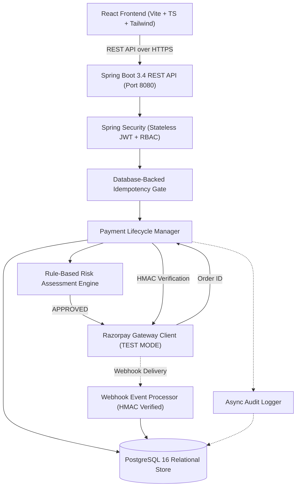

# PayShield — System Architecture

## Overview

**PayShield** is an authorization, fraud risk evaluation, and transaction monitoring platform designed for UPI payments integrated with Razorpay Gateway in **TEST MODE**.

## High-Level Architecture Diagram

## Security Architecture

1. **Separation of Concerns & Credential Protection**:
   - The React single-page application never receives or stores the `RAZORPAY_KEY_SECRET` or `RAZORPAY_WEBHOOK_SECRET`.
   - The frontend communicates solely with our backend; only the public `RAZORPAY_KEY_ID` is provided to initialize the Razorpay Standard Checkout modal.

2. **Server-Side Payment Signature Verification**:
   - Payment success callbacks from the frontend are treated as untrusted hints.
   - The backend verifies the HMAC-SHA256 signature calculated over `razorpay_order_id + "|" + razorpay_payment_id` using the server-held secret before any state transition to `CAPTURED`.

3. **Webhook Verification**:
   - Webhook requests sent to `/api/v1/webhooks/razorpay` require valid `X-Razorpay-Signature` calculated with the dedicated webhook secret.
   - Raw request bodies are preserved to avoid canonicalization attacks.
   - Duplicate delivery prevention is enforced through unique constraints on `razorpay_event_id`.

4. **Stateless JWT Authentication**:
   - Access tokens are signed using HMAC-SHA256 with a 256-bit secret key.
   - Passwords hashed using standard BCrypt (strength factor 12).
