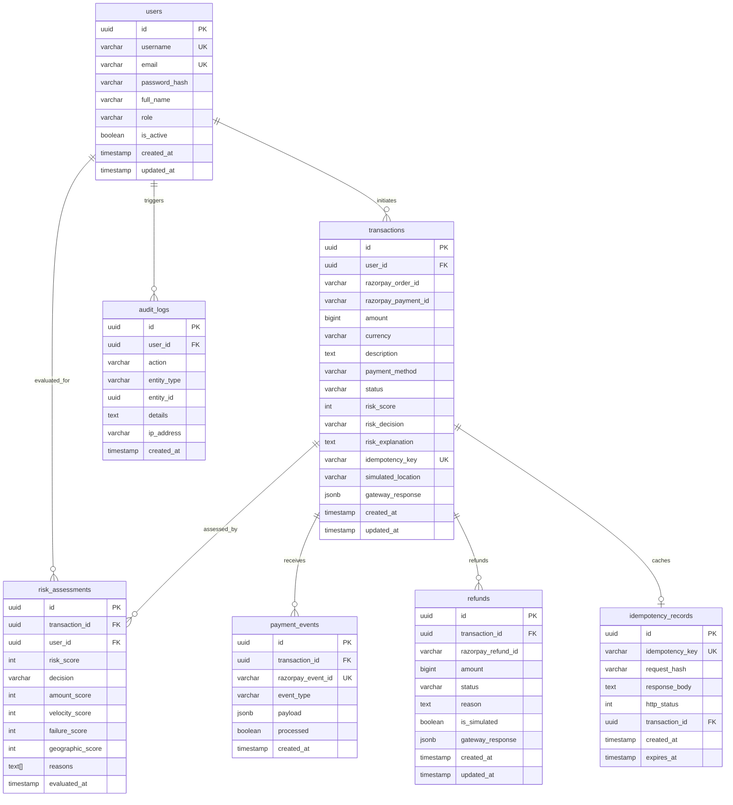

# PayShield — Database Design & Schema

PayShield utilizes PostgreSQL 16 managed via Flyway versioned migrations.

## Entity-Relationship Diagram

## Migration Catalog

1. `V1__create_users_table.sql`: Customer & Admin user entity with BCrypt hashes.
2. `V2__create_transactions_table.sql`: Primary transaction ledger storing minor units (paise) and gateway tokens.
3. `V3__create_payment_events_table.sql`: Webhook event deduplication ledger.
4. `V4__create_risk_assessments_table.sql`: Explainable breakdown of risk factor weights and reasons.
5. `V5__create_idempotency_records_table.sql`: Request-hash and response caching for network retry safety.
6. `V6__create_refunds_table.sql`: Lifecycle tracking for full and partial refunds with simulation support.
7. `V7__create_audit_logs_table.sql`: Security, authorization, and audit log table.
8. `V8__seed_admin_user.sql`: Production baseline reference (dynamic seeding handled by `DataInitializer`).
